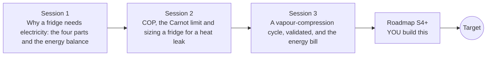

# openfridge

[](https://github.com/KrunalPanchal1995/openfridge/actions/workflows/ci.yml)   [](https://colab.research.google.com/github/KrunalPanchal1995/openfridge/blob/main/sessions/session-01/lesson.ipynb) [](https://krunalpanchal1995.github.io/openfridge/)

**Explain and size the fridge that keeps your food cold, in three sessions.**

openfridge teaches why a refrigerator needs electricity to move heat uphill, how to size one with the COP and the Carnot limit, and how a simplified vapour-compression cycle behaves, using only Python and a browser.

- **Start from the question.** Session 1 asks why a fridge must be plugged in, using only an energy balance.
- **See it move.** Every session ships a slider app that runs in the browser, with labelled graphs and a P-h diagram.
- **Know you got it right.** Each session ends with a checkpoint that prints PASS or FAIL against hand calculations and the Carnot limit.
- **Build the missing half.** The repo stops at Session 3 on purpose; the roadmap shows the path to the Target.

[Target](#the-target) · [Who is this for](#who-is-this-for) · [Quick start](#quick-start) · [Sessions](#sessions) · [Roadmap](#roadmap) · [Contribute](#contribute) · [Explainer PDF](docs/explainer.pdf)

> **This repo is incomplete on purpose.** Sessions 1 to 3 are here and fully working. The finished Target below is a preview of what the community can build next. We show you the path, not the code. Sessions 4 and up are yours.

## The Target

A kitchen warms and cools through a summer day. On the left, the refrigeration cycle breathes on a pressure-enthalpy diagram: the hotter the kitchen, the higher the condenser pressure and the longer the compressor stroke. On the right, bars show the heat taken from the food space, the compressor work and the heat given to the kitchen, with a live COP readout and a day-long COP curve. The Target uses a richer model than the repo (subcooling, superheat, heat exchangers sized by area, a compressor whose efficiency depends on the pressure ratio). Your goal over the coming sessions: build it yourself.


*Target: a refrigeration cycle on a P-h diagram through a summer day, with energy flows and live COP*

Try it live:

- [Math Visual Studio: the second law and entropy (Atlas S54)](https://krunalpanchal1995.github.io/studio/#atlas?ch=S54&ex=1)
- [Math Visual Studio: thermodynamic cycles (Atlas S55)](https://krunalpanchal1995.github.io/studio/#atlas?ch=S55&ex=1)

How the Target was made is shown only as a path in [promo/roadmap.md](promo/roadmap.md).

## Who is this for
**middle school to higher secondary (levels 2-4).** Topic area: Everyday Life and Practical Knowledge.

Prerequisites:

- Temperature, heat and energy at school level; kelvin is explained in Session 2.
- Python 3.10 or newer; if `python --version` works, you are ready. PRIMER.md explains the rest.
- No prior GitHub or thermodynamics experience is needed.

New to Python? Read [PRIMER.md](PRIMER.md) first (10 minutes).

## Quick start

No installation knowledge needed. You need [Git](https://git-scm.com/downloads) and [Python 3.10+](https://www.python.org/downloads/) (Windows: tick "Add Python to PATH"). On Mac and Linux type `python3` wherever this page says `python`.

```bash
git clone https://github.com/KrunalPanchal1995/openfridge.git
cd openfridge
python start.py 1
```

`start.py` creates a private environment, installs what is needed and runs Session 1 with its checkpoint. Next: `python start.py 2`, `python start.py 3`, or `python start.py test` to check everything. Only a checkpoint: `python start.py check 1`.

Four lines turn the idea of Session 2 into a result (they work as they are): Save it as `try.py` and run it with `python start.py run try.py` (this uses the private environment, where NumPy is installed):

```python
import numpy as np
t_cold, t_hot = 4 + 273.15, 25 + 273.15            # kelvin: inside and kitchen
cop_carnot = t_cold / (t_hot - t_cold)             # best possible COP
print(np.round(cop_carnot, 2))                     # -> 13.2
print(np.round(60 / (0.25 * cop_carnot), 1))       # -> 18.2 W of compressor power for a 60 W leak
```

Every session also opens in your browser with sliders (no install): [live apps](https://krunalpanchal1995.github.io/openfridge/). Or use the Colab badge above for the notebook.

## Sessions

| # | Session | Model level | Time | Live app |
|---|---|---|---|---|
| 1 | [Why a fridge needs electricity: the four parts and the energy balance](sessions/session-01/README.md) | Level 1: conceptual interactive model | 60 min | [open](https://krunalpanchal1995.github.io/openfridge/session-01/) |
| 2 | [COP, the Carnot limit and sizing a fridge for a heat leak](sessions/session-02/README.md) | Level 2: mathematical engineering model | 75 min | [open](https://krunalpanchal1995.github.io/openfridge/session-02/) |
| 3 | [A vapour-compression cycle, validated, and the energy bill](sessions/session-03/README.md) | Level 3: simulation and validation | 90 min | [open](https://krunalpanchal1995.github.io/openfridge/session-03/) |

Each session follows the same six steps: A real-world problem, B concept and theory, C visual explanation, D interactive simulation, E worked example and experiment, F assessment and design challenge. Each ends with `checkpoint.py`, which prints `PASS` or `FAIL` against reference numbers. Session 3 also contains the real-world mini-project: **Estimate the energy bill of a kitchen fridge**.

## Architecture



| Folder or file | What is inside |
|---|---|
| `sessions/` | three sessions: README (A-F), `lesson.py`, notebook, live app, exercises, activity sheet, checkpoint |
| `promo/` | the Target: media, live links, and the roadmap (path only) |
| `docs/` | `explainer.tex` and the built `explainer.pdf` |
| `tests/` | runs every lesson and checkpoint headless |
| `start.py` | one command to set up and run anything |
| `QUALITY.md`, `RUBRIC.md` | the quality checklist and the scoring rubric |
| `.github/` | CI, PDF build, Pages deploy, issue and PR templates |

## Roadmap

| Milestone | What you will build | Difficulty |
|---|---|---|
| Session 4: Replace the toy fluid by real property data | A property function built from a published table for one real refrigerant, used in the same cycle code. | intermediate |
| Session 5: Superheat and subcooling | Extend the cycle with two extra temperature offsets and show the effect on the P-h loop. | intermediate |
| Session 6: Size the heat exchangers | Replace the fixed offsets of 8 K and 10 K by values found from UA values with an iterative solution. | advanced |
| Session 7: Thermostat cycling over a day | A time-stepping simulation of the inside temperature with a thermostat and a thermal mass. | advanced |
| Session 8: Moisture and door openings | An improved door-load model with humid air. | advanced |

Full detail with a checkpoint per milestone: [promo/roadmap.md](promo/roadmap.md).

## Contribute
New to GitHub? Read [CONTRIBUTING.md](CONTRIBUTING.md); it starts from zero. Pick an issue labelled `good first issue`. Translations into Hindi, Telugu, Tamil and Malayalam are welcome.

<details>
<summary>Development</summary>

```bash
python start.py test        # runs every lesson and checkpoint
```
Lessons use `# %%` cell markers so they open as notebooks in VS Code. See [QUALITY.md](QUALITY.md) for the standard every session meets.
</details>

## License
MIT. See [LICENSE](LICENSE). Media in `promo/media` is (c) Krunal Panchal, CC BY 4.0.

## Acknowledgments
Part of the [PAN IIT OSS](https://hellofoss.tech-iitb.org/projects) open-source teaching collection, modelled on the structure of [openspline](https://github.com/openspline/openspline). Built on ideas from the Math Visual Studio at https://krunalpanchal1995.github.io/studio/.
