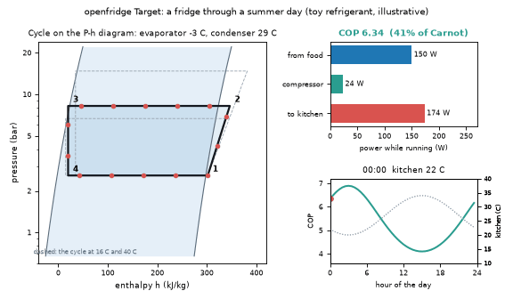

# What you are building toward

A kitchen warms and cools through a summer day. On the left, the refrigeration cycle breathes on a pressure-enthalpy diagram: the hotter the kitchen, the higher the condenser pressure and the longer the compressor stroke. On the right, bars show the heat taken from the food space, the compressor work and the heat given to the kitchen, with a live COP readout and a day-long COP curve. The Target uses a richer model than the repo (subcooling, superheat, heat exchangers sized by area, a compressor whose efficiency depends on the pressure ratio). Your goal over the coming sessions: build it yourself.

*Target: a refrigeration cycle on a P-h diagram through a summer day, with energy flows and live COP*

These results come from a private reference build. The code is not published; the roadmap shows the path so you can build your own.

Live links:

- [Math Visual Studio: the second law and entropy (Atlas S54)](https://krunalpanchal1995.github.io/studio/#atlas?ch=S54&ex=1)
- [Math Visual Studio: thermodynamic cycles (Atlas S55)](https://krunalpanchal1995.github.io/studio/#atlas?ch=S55&ex=1)
