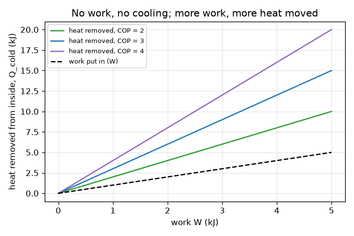
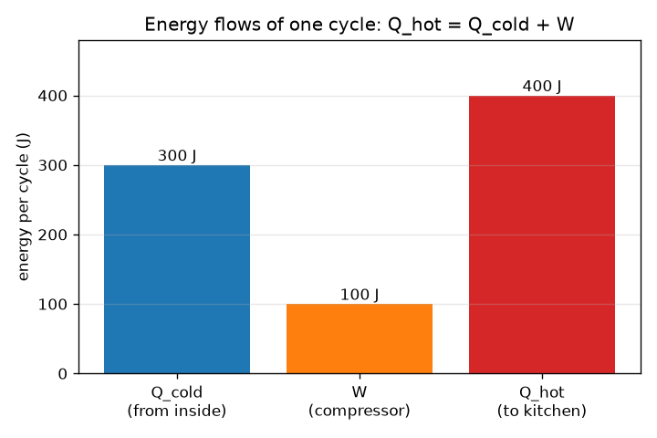

# Session 1: Why a fridge needs electricity: the four parts and the energy balance

*Level 1 (conceptual interactive model) · about 60 minutes · openfridge*

> This is a simplified educational model. It is not a validated design tool and must not be used for real structures, electrical installations, vehicles, industrial processes or medical decisions.

**Prerequisites**

- Heat and temperature at school level.
- You have read PRIMER.md and run `python start.py 1` once.

**Learning objectives.** After this session you can:

- Name the four parts of a refrigerator and what each does.
- State the energy balance Q_hot = Q_cold + W and use it with numbers.
- Define the coefficient of performance (COP) and explain why it can be larger than 1.
- Explain why heat moves from the cold inside to the warm kitchen only when work is supplied.

## A. Real-world problem
Leave a warm drink on a table and it cools to room temperature on its own: heat flows from warm to cold. A refrigerator keeps its inside colder than the kitchen, so heat must move the other way. Why does the fridge have to be plugged in, and where does the heat go? (Touch the back or side of a fridge: it is warm.)

## B. Concept and theory
A refrigerator is a loop of fluid with four parts. The evaporator, inside the food space, lets the fluid boil at low pressure and low temperature, so it takes heat Q_cold from the inside. The compressor squeezes the vapour to high pressure and heats it, using electric work W. The condenser, at the back, gives heat Q_hot to the kitchen as the hot vapour turns back to liquid. The expansion valve drops the pressure so the liquid becomes cold again. Over one full turn the fluid returns to where it started, so it stores no energy: Q_hot = Q_cold + W. Heat does not flow from cold to warm by itself (the second law, in Clausius's form); the compressor work is what pays for moving it. The COP is the heat removed per unit of work, COP = Q_cold / W. It can exceed 1 because the fridge moves heat; it does not create it.

| Symbol | Meaning | Unit |
|---|---|---|
| Q_cold | heat taken from the cold inside per cycle | kJ |
| W | work put in by the compressor per cycle | kJ |
| Q_hot | heat given to the warm kitchen per cycle | kJ |
| COP | coefficient of performance, Q_cold / W | no unit |
| UA | wall leakiness: leak power per kelvin of temperature difference | W/K |

**Assumptions**

- One steady cycle: the fluid returns to its starting state.
- Heat and work are counted as positive amounts, with the arrows showing their direction.
- The numbers in the app are illustrative values for a conceptual model, not data for a real fridge.

$$ Q_{\mathrm{hot}}=Q_{\mathrm{cold}}+W $$

$$ \mathrm{COP}=\frac{Q_{\mathrm{cold}}}{W} $$

$$ Q_{\mathrm{cold}}=\mathrm{COP}\times W,\qquad Q_{\mathrm{hot}}=(\mathrm{COP}+1)\,W $$

$$ P_{\mathrm{leak}}=UA\,(T_{\mathrm{room}}-T_{\mathrm{inside}}) $$

## C. Visual explanation
The first figure is a bar chart of one cycle: 300 J taken from the inside plus 100 J of work give 400 J to the kitchen. The second figure plots the heat removed against the work for three values of COP: each line starts at zero, because with no work nothing is moved, and its slope is the COP. The dashed line is the work itself; the gap between a line and the dashed line shows how much more heat is moved than the work paid for.

*Heat removed against work for three COP values: the slope is the COP, and zero work moves nothing.*

*One cycle: 300 J from the inside plus 100 J of work give 400 J to the kitchen.*

## D. Interactive simulation
Run the lesson (`python start.py 1`), then open the live app: [Session 1: work moves heat uphill](https://krunalpanchal1995.github.io/openfridge/session-01/) (or `app.html` in this folder). Move the work slider to zero and watch every arrow disappear. Raise the COP slider and see that more heat is moved for the same work. Switch to the loop view to follow the fluid, and to the graph to see the lines.

**Challenge.** Remove at least 6 kJ of heat from the inside using at most 2 kJ of work, with a COP of at most 4.

## E. Worked example and experiment
**Problem.** A fridge takes 300 J from the inside in one cycle and uses 100 J of work. How much heat does it give to the kitchen, and what is its COP? Then: walls with UA = 2.0 W/K, a 25 C kitchen and 4 C inside; how much heat must a fridge remove every second?

1. Energy balance: Q_hot = Q_cold + W = 300 + 100 = 400 J.
2. COP = Q_cold / W = 300 / 100 = 3.
3. Check the direction: more heat leaves (400 J) than enters from the inside (300 J); the extra 100 J is the work.
4. Leak power = UA x (T_room - T_inside) = 2.0 x (25 - 4) = 2.0 x 21 = 42 W, so the fridge must remove 42 J every second.

**Answer.** Q_hot = 400 J and COP = 3. The walls leak 42 W, which the fridge must remove to hold 4 C.

**Experiment.** Put a plug-in energy meter on a fridge that is not being opened and read the energy over a few hours, then feel the warm side or back panel. The kitchen receives the electrical energy plus the heat taken from the food, as Q_hot = Q_cold + W says. The simple model has one number for the whole loop; a real fridge also runs fans, lights and defrost, and its compressor switches on and off, so the meter reading is higher and varies.

## F. Assessment and design challenge
**Question type A: Conceptual.** Why can a refrigerator move heat from a cold interior to a warmer room only when energy is supplied? Why does the room get warmer, not colder, if you leave a fridge door open in a closed kitchen?

Hint

Think about which way heat flows by itself, and use Q_hot = Q_cold + W.

Step-by-step solution

Heat flows by itself only from warm to cold; moving it the other way is not spontaneous, so something must pay for it, and the compressor's electrical work W does. The energy balance Q_hot = Q_cold + W shows that the kitchen receives all the heat taken from the inside plus the work. With the door open in a closed kitchen the fridge takes heat from the kitchen air and gives back more (Q_cold + W), so the net effect on the room is the work W: it warms the kitchen a little, it never cools it.

**Question type B: Numerical.** A fridge takes 450 J from the inside using 150 J of work. Find Q_hot and the COP, with units and a sanity check.

Hint

Q_hot = Q_cold + W and COP = Q_cold / W.

Step-by-step solution

Q_hot = 450 + 150 = 600 J. COP = 450 / 150 = 3 (no unit). Sanity check: Q_hot is larger than Q_cold, and the COP is positive; the difference Q_hot - Q_cold equals the work 150 J.

**Question type C: Graph and simulation interpretation.** In the graph of heat removed against work, what does the slope of each line mean? What is the heat removed at W = 2 kJ for COP = 3, and at W = 0?

Hint

Read the line for COP = 3 at W = 2, and look at where each line starts.

Step-by-step solution

The slope is Q_cold / W, which is the COP. At W = 2 kJ and COP = 3 the heat removed is 6 kJ. At W = 0 every line gives 0: with no work nothing is moved. A steeper line means a better fridge, because it moves more heat for each kJ of work.

**Question type D: Design and optimisation challenge.** Design: the walls leak 42 W (UA = 2.0 W/K, 25 C kitchen, 4 C inside). You can choose a fridge with COP 2.5 or COP 3.5, and your supply allows at most 15 W for the compressor. Which choices work, what is the compressor power for each, and how much heat does each give to the kitchen?

Hint

In steady state Q_cold = 42 W, so W = Q_cold / COP and Q_hot = Q_cold + W.

Step-by-step solution

COP 2.5: W = 42 / 2.5 = 16.8 W, which is above the 15 W limit, so it does not work. COP 3.5: W = 42 / 3.5 = 12.0 W, which works. Heat to the kitchen for the COP 3.5 fridge: 42 + 12 = 54 W (for COP 2.5 it would be 58.8 W). Trade-off: a higher COP costs more to build; assumption: steady state and a constant COP.

Score yourself with [RUBRIC.md](../../RUBRIC.md). Print the [activity sheet](activity_sheet.md) to work on paper.

## Common misconceptions
| Common misconception | What is actually true |
|---|---|
| A fridge makes cold. | A fridge moves heat. Cold is the absence of heat, and the heat taken from the inside is dumped into the kitchen. |
| A COP above 1 breaks energy conservation. | COP is heat moved divided by work. The extra heat is not created, it is moved from the inside to the room; Q_hot = Q_cold + W still balances. |
| Heat can flow from cold to warm if the fridge is good enough. | Never without work. The second law says moving heat uphill always needs energy input. |
| Leaving the door open cools the kitchen. | The kitchen gets the work as extra heat, so it warms slightly. |

## Glossary
- **evaporator**: the heat exchanger inside the food space where the fluid boils and takes heat
- **condenser**: the heat exchanger at the back where the hot vapour gives heat to the kitchen and turns to liquid
- **compressor**: the pump driven by an electric motor that raises the pressure of the vapour
- **expansion valve**: a narrow opening that lowers the pressure of the liquid so it becomes cold
- **COP**: coefficient of performance: heat removed divided by work put in
- **refrigerant**: the working fluid that circulates in the loop

## Finish
1. Do the three coding tasks in [exercises.md](exercises.md).
2. Run `python start.py 1` again after your changes. It ends with the checkpoint; when it prints `PASS`, you are done. (Checkpoint only: `python start.py check 1`.)

Next: [Session 2](../session-02/README.md)
