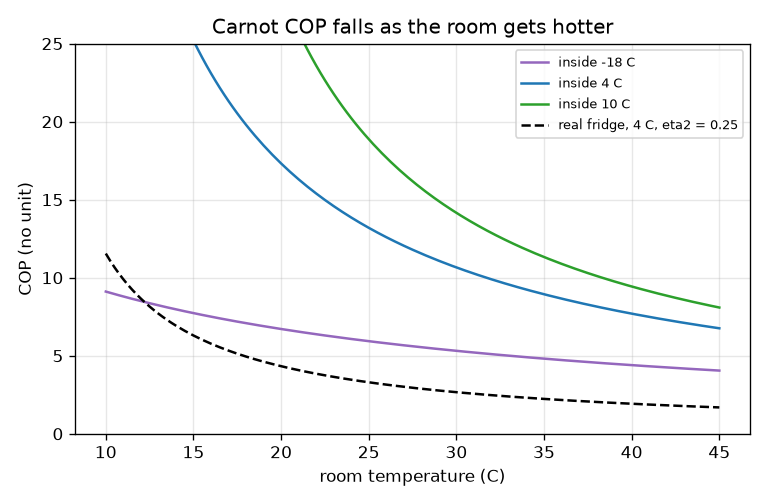
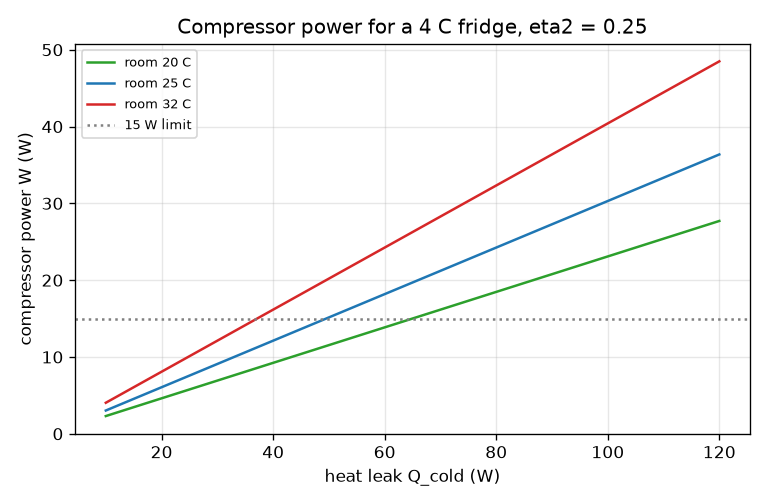

# Session 2: COP, the Carnot limit and sizing a fridge for a heat leak

*Level 2 (mathematical engineering model) · about 75 minutes · openfridge*

> This is a simplified educational model. It is not a validated design tool and must not be used for real structures, electrical installations, vehicles, industrial processes or medical decisions.

**Prerequisites**

- Session 1: energy balance and COP.
- Temperature in kelvin is explained in Section B.

**Learning objectives.** After this session you can:

- Convert temperatures to kelvin and compute the Carnot COP T_c / (T_h - T_c).
- Compute the compressor power and the heat given to the kitchen for a given heat leak.
- Explain why a hotter kitchen or a colder inside lowers the COP.
- Solve the inverse problem: which kitchen temperature or efficiency fraction meets a power limit?

## A. Real-world problem
A kitchen fridge holds 4 C inside while the kitchen is 25 C, and heat leaks in through the walls all day. How much electric power must the compressor use? Why does the same fridge use more power in a hot summer kitchen? And is there a best possible fridge, so that no company could ever beat it?

## B. Concept and theory
The best possible COP depends only on the two temperatures, measured in kelvin: T(K) = T(C) + 273.15. A reversible fridge working between a cold space at T_c and a warm room at T_h has COP_Carnot = T_c / (T_h - T_c). Any real fridge is below this limit; we write COP = eta2 x COP_Carnot, where eta2 (between 0 and 1) collects all real losses. In steady state the fridge removes exactly the heat that leaks in, Q_cold = leak, so the compressor power is W = Q_cold / COP, and the kitchen receives Q_hot = Q_cold + W. A smaller temperature difference T_h - T_c means a larger COP, so a hot kitchen or a colder inside needs more power. The limit follows from the second law: a cycle that beat it would make the total entropy of the fridge and its surroundings decrease.

| Symbol | Meaning | Unit |
|---|---|---|
| T_c | temperature of the cold space (inside) | K |
| T_h | temperature of the warm room (kitchen) | K |
| COP_Carnot | best possible COP between T_c and T_h | no unit |
| eta2 | fraction of the Carnot COP actually reached | no unit |
| Q_cold | heat removed per second (equal to the leak in steady state) | W |
| W | electric power used by the compressor | W |
| Q_hot | heat given to the kitchen per second | W |

**Assumptions**

- Steady state: the inside temperature does not change.
- The temperatures are those of the inside and the kitchen; real losses are all folded into eta2.
- The Carnot formula needs T_h greater than T_c, both in kelvin.
- The heat leak is a given number; it is not computed from the walls here.

$$ T(\mathrm{K})=T(^{\circ}\mathrm{C})+273.15 $$

$$ \mathrm{COP}_{\mathrm{Carnot}}=\frac{T_c}{T_h-T_c},\qquad \mathrm{COP}=\eta_2\,\mathrm{COP}_{\mathrm{Carnot}} $$

$$ W=\frac{Q_{\mathrm{cold}}}{\mathrm{COP}},\qquad Q_{\mathrm{hot}}=Q_{\mathrm{cold}}+W $$

$$ T_h=T_c+\eta_2\,T_c\,\frac{W}{Q_{\mathrm{cold}}} $$

## C. Visual explanation
The first figure plots the Carnot COP against the room temperature for three inside temperatures. Every curve falls as the room gets hotter, and the freezer curve (-18 C) is much lower than the fridge curve (4 C): moving heat across a bigger temperature difference costs more work. The dashed line is a real fridge with eta2 = 0.25, a quarter of the Carnot value. The second figure plots the compressor power against the heat leak: a straight line whose slope is 1/COP, steeper for a hotter room, with the 15 W limit marked.

*Carnot COP against room temperature for three inside temperatures, with a real fridge (eta2 = 0.25) dashed.*

*Compressor power against heat leak for three room temperatures; the 15 W limit is dotted.*

## D. Interactive simulation
Run the lesson (`python start.py 2`), then open the live app: [Session 2: sizing a fridge](https://krunalpanchal1995.github.io/openfridge/session-02/) (or `app.html` in this folder). Raise the room temperature and watch the COP curve move and the power arrow grow. Raise the efficiency fraction eta2 and see the power fall. Open the formula panel in the flow view and check each line by hand.

**Challenge.** Hold a 60 W leak or more in a kitchen of at least 32 C while keeping the compressor power at or below 15 W.

## E. Worked example and experiment
**Problem.** A fridge holds 4 C in a 25 C kitchen. The heat leak is 60 W and eta2 = 0.25. Find the Carnot COP, the real COP, the compressor power and the heat given to the kitchen.

1. Convert: T_c = 4 + 273.15 = 277.15 K and T_h = 25 + 273.15 = 298.15 K, so T_h - T_c = 21 K.
2. COP_Carnot = 277.15 / 21 = 13.20.
3. COP = 0.25 x 13.20 = 3.30.
4. W = Q_cold / COP = 60 / 3.30 = 18.2 W.
5. Q_hot = 60 + 18.2 = 78.2 W. Check: Q_hot / W is 4.3 = COP + 1.

**Answer.** Carnot COP 13.20, real COP 3.30, compressor power 18.2 W, heat to the kitchen 78.2 W.

**Experiment.** Measure the average power of a fridge in a cool room and in a warm room (an energy meter over a day each) and compare the ratio with the model: the model predicts that a hotter kitchen needs more power (at 35 C instead of 25 C the same fridge would need 26.8 W instead of 18.2 W for the same 60 W leak, if eta2 stayed 0.25). Real fridges differ because the leak itself grows with the temperature difference, because eta2 changes with the conditions and because of the fans, defrost and compressor starts that the model leaves out.

## F. Assessment and design challenge
**Question type A: Conceptual.** Why can no fridge have a COP above the Carnot value? And why does a freezer at -18 C have a lower Carnot COP than a fridge at 4 C in the same kitchen?

Hint

Look at the formula T_c / (T_h - T_c) and ask what happens to the numerator and the denominator.

Step-by-step solution

A fridge with a higher COP would take heat from the cold space and give it to the room with less work than the best reversible cycle, which would make the total entropy of the fridge and surroundings decrease; the second law forbids it. For the freezer, the temperature difference is larger (43 K instead of 21 K) and T_c is smaller, so T_c / (T_h - T_c) is much smaller: 255.15 / 43 = 5.93 against 13.20.

**Question type B: Numerical.** A fridge holds 5 C in a 30 C kitchen with a 40 W heat leak and eta2 = 0.30. Find the Carnot COP, the real COP, the compressor power and Q_hot.

Hint

Use kelvin: T_c = 278.15 K, T_h = 303.15 K.

Step-by-step solution

T_h - T_c = 25 K. COP_Carnot = 278.15 / 25 = 11.13. COP = 0.30 x 11.13 = 3.34. W = 40 / 3.34 = 12.0 W. Q_hot = 40 + 12.0 = 52.0 W. Sanity check: W is smaller than Q_cold, and Q_hot is larger than both.

**Question type C: Graph and simulation interpretation.** On the COP graph for a 4 C inside, estimate by what fraction the Carnot COP falls when the kitchen goes from 25 C to 35 C. Confirm with the formula.

Hint

Read the curve at 25 C and at 35 C and take the ratio; the formula ratio is 21 / 31.

Step-by-step solution

The curve reads about 13.2 at 25 C and about 8.9 at 35 C. The ratio is 8.94 / 13.20 = 0.68, so the COP falls by about a third. The formula gives the same ratio, (T_h - T_c) at 25 C divided by that at 35 C, 21 / 31 = 0.68. The same fridge therefore needs about 1.5 times the power in the hotter kitchen.

**Question type D: Design and optimisation challenge.** Design: the heat leak is 60 W, the inside is 4 C and the compressor power must not exceed 15 W. Find the warmest kitchen allowed if eta2 = 0.30. Then, for a 32 C kitchen, find the least eta2 that meets the limit. State the trade-off.

Hint

Use T_h = T_c + eta2 T_c W / Q_cold for the first part, and COP = Q_cold / W for the second.

Step-by-step solution

First part: T_h = 277.15 + 0.30 x 277.15 x 15 / 60 = 277.15 + 20.79 = 297.94 K, which is 24.8 C. Second part: at 32 C, COP_Carnot = 277.15 / 28 = 9.90; the needed COP is 60 / 15 = 4, so eta2 must be at least 4 / 9.90 = 0.404. With eta2 = 0.30 the power would be 20.2 W, too high. Trade-off: a higher eta2 needs a better compressor and larger heat exchangers (higher cost), while a smaller leak (more insulation) lowers the power for the same fridge. Assumption: steady state and a constant eta2.

Score yourself with [RUBRIC.md](../../RUBRIC.md). Print the [activity sheet](activity_sheet.md) to work on paper.

## Common misconceptions
| Common misconception | What is actually true |
|---|---|
| Temperature differences in Celsius are enough for the Carnot COP. | The numerator T_c must be in kelvin; using 4 instead of 277.15 gives a wrong COP. The difference T_h - T_c is the same in C and K. |
| A bigger compressor always means a better COP. | COP depends on the temperatures and the losses, not on the size. A bigger compressor changes the capacity, not the limit. |
| COP is the efficiency and cannot exceed 100 percent. | The COP of a fridge is heat moved over work and is normally above 1. eta2 is the efficiency-like number and stays below 1. |
| The Carnot COP is a target a good design will reach. | It is an upper bound for a reversible cycle between the same two temperatures; real fridges reach a fraction of it. |

## Glossary
- **kelvin**: the absolute temperature scale: T(K) = T(C) + 273.15
- **Carnot COP**: the highest COP any fridge can have between two temperatures
- **eta2**: the fraction of the Carnot COP a real fridge reaches (second-law efficiency)
- **heat leak**: heat that flows into the cold space through the walls and door seal
- **steady state**: nothing changes with time: the inside temperature is constant

## Finish
1. Do the three coding tasks in [exercises.md](exercises.md).
2. Run `python start.py 2` again after your changes. It ends with the checkpoint; when it prints `PASS`, you are done. (Checkpoint only: `python start.py check 2`.)

Next: [Session 3](../session-03/README.md)
