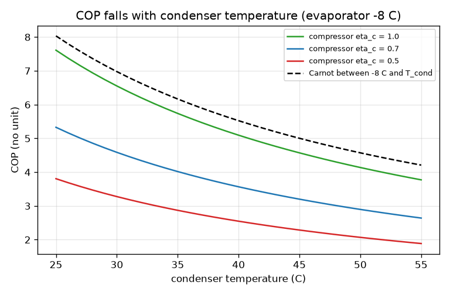
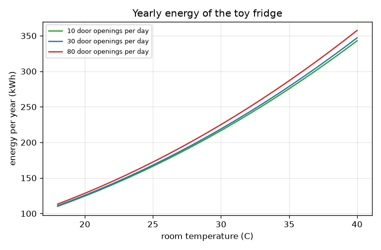
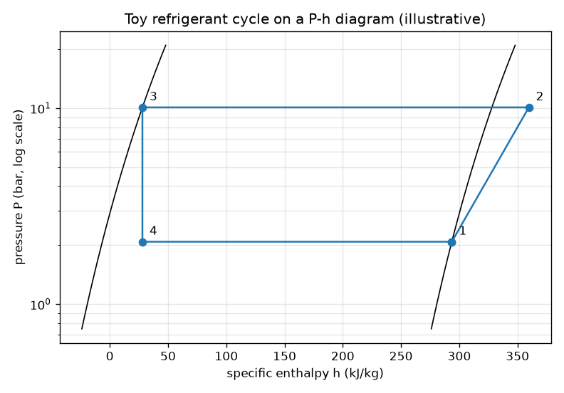

# Session 3: A vapour-compression cycle, validated, and the energy bill

*Level 3 (simulation and validation) · about 90 minutes · openfridge*

> This is a simplified educational model. It is not a validated design tool and must not be used for real structures, electrical installations, vehicles, industrial processes or medical decisions.

**Prerequisites**

- Session 1: energy balance and COP.
- Session 2: kelvin and the Carnot limit.

**Learning objectives.** After this session you can:

- Compute the four states of a simplified vapour-compression cycle and read them on a P-h diagram.
- Include a compressor efficiency and find the COP from enthalpies.
- Validate the model: energy balance, an isentropic check and the Carnot bound.
- Measure the sensitivity of the COP to the condenser temperature and estimate a yearly energy bill including door openings.

## A. Real-world problem
Session 2 assumed that a real fridge reaches a fraction eta2 of the Carnot COP. Where does that fraction come from? In a real fridge the fluid must be colder than the food to take its heat and hotter than the kitchen to give heat to it, and the compressor is not perfect. How much does that cost, how does the COP change when the kitchen gets hot, and what does a fridge cost to run in a year? Note: the working fluid here is a toy refrigerant with illustrative numbers, not any real refrigerant.

## B. Concept and theory
The cycle has four states. State 1: saturated vapour leaves the evaporator at T_evap. Compression to the condenser pressure is ideally isentropic (state 2s); for an ideal-gas vapour T_2s = T_1 (P_cond / P_evap)^(R / cp). A real compressor with isentropic efficiency eta_c needs more work: h_2 = h_1 + (h_2s - h_1) / eta_c. State 3: saturated liquid leaves the condenser at T_cond. The expansion valve does no work and exchanges no heat, so h_4 = h_3 and the liquid partly flashes to vapour. The toy fluid uses the same cp for liquid and vapour and a constant latent heat L, which makes P_sat follow the Clausius-Clapeyron relation exactly. Per kilogram of fluid: q_evap = h_1 - h_4, work = h_2 - h_1, q_cond = h_2 - h_3, and COP = q_evap / work. For the whole fridge the evaporator is dt_ev colder than the inside and the condenser dt_cd hotter than the kitchen; then eta2 = COP / COP_Carnot(inside, kitchen) is a result. Validation: q_cond = q_evap + work; state 2s has the same entropy as state 1; the COP stays below the Carnot value; and entropy is generated. Energy per year follows from the load (walls plus door openings), the duty cycle d = load / capacity and the electric power while running, capacity / COP.

| Symbol | Meaning | Unit |
|---|---|---|
| T_evap, T_cond | evaporator and condenser temperatures of the refrigerant | C |
| P_sat | saturation pressure | bar |
| h | specific enthalpy (zero for liquid at 0 C) | kJ/kg |
| cp, L, R | toy fluid: specific heat 0.8, latent heat 300, gas constant 0.10 | kJ/(kg K), kJ/kg, kJ/(kg K) |
| eta_c | compressor isentropic efficiency | no unit |
| q_evap, work, q_cond | heat taken, work and heat given per kg of fluid | kJ/kg |
| d | duty cycle: fraction of time the compressor runs | no unit |
| E | energy per year | kWh |

**Assumptions**

- Toy refrigerant with illustrative numbers; not any real fluid.
- Vapour is an ideal gas; liquid has no volume change; latent heat is constant.
- No pressure drops, no superheating or subcooling, steady state in the cycle.
- Door load counts sensible heat of the air only; moisture is ignored, so real door loads are larger.
- Education only; not a design tool for real appliances and the tariff is an illustration, not financial advice.

$$ P_{\mathrm{sat}}(T)=P_0\exp\!\left[-\frac{L}{R}\left(\frac1T-\frac1{T_0}\right)\right] $$

$$ T_{2s}=T_1\left(\frac{P_{\mathrm{cond}}}{P_{\mathrm{evap}}}\right)^{R/c_p},\qquad h_2=h_1+\frac{h_{2s}-h_1}{\eta_c} $$

$$ h_4=h_3,\qquad \mathrm{COP}=\frac{h_1-h_4}{h_2-h_1} $$

$$ q_{\mathrm{cond}}=q_{\mathrm{evap}}+w,\qquad \mathrm{COP}\le\frac{T_{\mathrm{evap}}}{T_{\mathrm{cond}}-T_{\mathrm{evap}}} $$

$$ E=\left(d\,\frac{\dot Q_{\mathrm{cap}}}{\mathrm{COP}}+P_{\mathrm{overhead}}\right)\times 8760\ \mathrm{h},\qquad d=\frac{UA\,\Delta T+\dot Q_{\mathrm{door}}}{\dot Q_{\mathrm{cap}}} $$

## C. Visual explanation
The first figure is the cycle on a pressure-enthalpy (P-h) diagram, with pressure in bar on a log scale. The dome is bounded by saturated liquid on the left and saturated vapour on the right. State 1 is on the right line at low pressure; the compressor lifts the fluid to state 2 at high pressure (the longer the horizontal stretch 1 to 2, the more work); the condenser takes it left to state 3; the expansion valve drops it straight down to state 4 at the same enthalpy. The horizontal length 4 to 1 is the heat taken from the food, and 2 to 3 the heat given to the kitchen. The second figure shows the COP against the condenser temperature for three compressor efficiencies, below the dashed Carnot line; the third shows the yearly energy against the room temperature for three numbers of door openings.

*COP against condenser temperature for three compressor efficiencies, below the Carnot limit.*

*Yearly energy of the toy fridge against room temperature for three door-opening rates.*

*The toy refrigerant cycle on a P-h diagram (evaporator -8 C, condenser 35 C, eta_c = 0.7).*

## D. Interactive simulation
Run the lesson (`python start.py 3`), then open the live app: [Session 3: the simplified vapour-compression cycle](https://krunalpanchal1995.github.io/openfridge/session-03/) (or `app.html` in this folder). Move the condenser temperature up and watch state 2 and 3 climb and the work grow. Lower the compressor efficiency and see state 2 move right while the COP falls. Switch to the COP graph and compare the cycle with the Carnot limit.

**Challenge.** Reach a COP of at least 5.5 with the condenser at or above 35 C (a warm kitchen) and the evaporator at or below -5 C (to keep food cold).

## E. Worked example and experiment
**Problem.** Evaporator at -8 C, condenser at 35 C, compressor efficiency 0.7. Find the pressures, the work, the heat taken per kilogram and the COP, and check the energy balance.

1. Pressures: P_evap = 2.08 bar and P_cond = 10.10 bar, so the pressure ratio is 4.85.
2. h_1 = 0.8 x (-8) + 300 = 293.6 kJ/kg and h_3 = 0.8 x 35 = 28.0 kJ/kg, with h_4 = h_3 = 28.0.
3. q_evap = h_1 - h_4 = 293.6 - 28.0 = 265.6 kJ/kg.
4. T_2s = 265.15 x 4.85^0.125 = 265.15 x 1.218 = 323.0 K, which is 49.8 C; the ideal work is 0.8 x (323.0 - 265.15) = 46.3 kJ/kg.
5. Real work = 46.3 / 0.7 = 66.1 kJ/kg, so COP = 265.6 / 66.1 = 4.02.
6. q_cond = h_2 - h_3 = 359.7 - 28.0 = 331.7 kJ/kg, and q_evap + work = 265.6 + 66.1 = 331.7. The energy balance closes.
7. Carnot between -8 C and 35 C: 265.15 / 43 = 6.17, and 4.02 is below it, as it must be.

**Answer.** P_evap 2.08 bar, P_cond 10.10 bar, work 66.1 kJ/kg, q_evap 265.6 kJ/kg, COP 4.02 (below the Carnot value 6.17). For a whole fridge holding 4 C in a 25 C kitchen the same cycle (evaporator -4 C, condenser 35 C) gives COP 4.53, which is 0.34 of the Carnot COP 13.20: the fraction eta2 of Session 2 is now a result.

**Experiment.** Compare with a real fridge: put an energy meter on one for 24 hours in a room of known temperature, and compare the daily energy with the model (about 0.54 kWh a day at 28 C for the parameters of the mini-project). Differences come from things the toy model leaves out: defrost heaters, fans, lights, moisture from the air, food loads, compressor starts and a real refrigerant that is not an ideal gas. Model versus reality: the model gets the direction and the rough size of the effects of room temperature right; it is not a prediction for a specific appliance.

## Real-world application and mini-project: Estimate the energy bill of a kitchen fridge
A household in a hot city wants a rough idea of what its fridge costs to run, and whether the compressor has enough margin. Use `fridge_year` from Session 3 (wall leak UA = 3.0 W/K, 4 C inside, cooling capacity 150 W, compressor efficiency 0.7, 5 W of fans and lights, 30 door openings a day). General education only; the tariff of 8 per kWh is an illustration, not advice. Estimate the yearly energy and cost for kitchens at 22, 28 and 34 C, then find the warmest whole-degree kitchen for which the compressor runs no more than 60 percent of the time.

**Deliverable:** A script that prints, for 22, 28 and 34 C, the load in watts, the duty cycle, the COP, the yearly energy in kWh and the cost; prints the warmest whole-degree kitchen with duty at most 0.6; and saves a plot of yearly energy against room temperature for 10, 30 and 80 door openings a day.

**Success looks like:** Yearly energy is about 142, 198 and 266 kWh for 22, 28 and 34 C (duty 0.37, 0.49 and 0.61), and the warmest kitchen with duty at most 0.6 is 33 C. The three-season average is about 202 kWh a year.

## F. Assessment and design challenge
**Question type A: Conceptual.** Why does the COP of the cycle fall when the condenser temperature rises, even though nothing else changes? Why is the cycle COP always below the Carnot COP?

Hint

Look at the pressure ratio and the length of the compression 1 to 2 on the P-h diagram.

Step-by-step solution

A hotter condenser means a higher condenser pressure, a larger pressure ratio and a longer horizontal stretch from 1 to 2: the work rises, while the heat taken from the food (h_1 - h_4) even falls because h_3 is larger. COP = q_evap / work therefore falls. The cycle is below Carnot because the compressor is not isentropic, the valve wastes the expansion work and the heat exchange happens across finite temperature differences, all of which generate entropy; the checkpoint verifies that the entropy generated is positive.

**Question type B: Numerical.** For the cycle in the worked example, find the COP if the compressor efficiency is 0.5 instead of 0.7. Show how the result follows from the isentropic work.

Hint

work = ideal work / eta_c, so COP is proportional to eta_c.

Step-by-step solution

The ideal work is 46.3 kJ/kg, so the real work is 46.3 / 0.5 = 92.6 kJ/kg. q_evap is unchanged at 265.6 kJ/kg, so COP = 265.6 / 92.6 = 2.87. Check: 4.02 x 0.5 / 0.7 = 2.87. Units: COP has no unit; work and heat in kJ/kg.

**Question type C: Graph and simulation interpretation.** On the COP graph (evaporator -8 C, eta_c = 0.7) read the COP at condenser temperatures of 25 C and 45 C. How large is the fall, and how far below the Carnot line is the cycle?

Hint

Read the blue curve and the grey Carnot curve at each condenser temperature.

Step-by-step solution

The cycle gives COP 5.33 at 25 C and 3.20 at 45 C, a fall of 40 percent. The Carnot values are 265.15 / 33 = 8.04 and 265.15 / 53 = 5.00, so the cycle reaches about 66 percent and 64 percent of Carnot between the two evaporator and condenser temperatures. A hot kitchen costs about 40 percent of the COP for 20 K more condenser temperature.

**Question type D: Design and optimisation challenge.** Design: with capacity 150 W, UA = 3.0 W/K, 4 C inside, 30 door openings a day and compressor efficiency 0.7, find the warmest whole-degree kitchen for which the compressor runs at most 60 percent of the time. Then say what happens at 34 C and what you could change.

Hint

Use fridge_year(t_room)['duty'] for each whole-degree room temperature.

Step-by-step solution

The duty is 0.592 at 33 C and 0.613 at 34 C, so the warmest kitchen is 33 C. At 34 C the compressor runs 61 percent of the time and uses about 266 kWh a year against 254 kWh at 33 C. To bring the duty down you can reduce the load (better insulation lowers UA, fewer door openings) or raise the capacity (a bigger compressor), but a bigger compressor starts and stops more often and costs more. Assumptions: steady load, sensible door load only.

Score yourself with [RUBRIC.md](../../RUBRIC.md). Print the [activity sheet](activity_sheet.md) to work on paper.

## Common misconceptions
| Common misconception | What is actually true |
|---|---|
| The refrigerant temperature equals the food temperature. | The evaporator must be colder than the food and the condenser hotter than the kitchen, or no heat would flow; this is one reason eta2 is below 1. |
| The expansion valve does useful work. | It only lowers the pressure at constant enthalpy; the energy that a turbine could recover is lost. |
| The model proves a real fridge uses exactly the energy it predicts. | It is a toy model with illustrative fluid numbers; real energy use includes fans, defrost, moisture and cycling. |
| Door openings are the main cost of a fridge. | In this model the room temperature matters far more than the number of door openings (sensible heat only); real moisture makes doors matter more. |

## Glossary
- **P-h diagram**: a plot of pressure against enthalpy on which the refrigeration cycle is a closed loop
- **enthalpy**: the heat content per kilogram of a flowing fluid, in kJ/kg
- **isentropic**: reversible and without heat exchange: entropy stays constant
- **saturation**: the pressure and temperature at which liquid and vapour coexist
- **duty cycle**: the fraction of time the compressor is running
- **flash**: partial boiling of a liquid when its pressure drops suddenly

## Finish
1. Do the three coding tasks in [exercises.md](exercises.md).
2. Run `python start.py 3` again after your changes. It ends with the checkpoint; when it prints `PASS`, you are done. (Checkpoint only: `python start.py check 3`.)

Next: the [roadmap](../../promo/roadmap.md). Session 4 is yours to build.
